# RTL Design and Validation of UART using Spartan-7

A complete UART transmitter and receiver in Verilog, running on a Spartan-7 FPGA
(Digilent Arty S7-25). The design was first verified in simulation with a
self-checking testbench, then validated on hardware with automated Python tests.

The hardware design is an echo: bytes sent from the PC are received by the FPGA,
shown on the LEDs, and transmitted straight back.

The project contains two designs:
- **UART transmitter and receiver** (`design/uart_tx.v`, `design/uart_rx.v`)
- **Synchronous FIFO** (`design/fifo.v`), designed and unit-tested on its own, then
  placed between the receiver and the transmitter so bytes sent back to back are
  never lost.

## Specification
- **Board:** Digilent Arty S7-25 (AMD Spartan-7 XC7S25)
- **Clock:** 12 MHz (onboard oscillator)
- **Baud rate:** 115200 bps (configurable through the `CLKS_PER_BIT` parameter)
- **Bit period:** 12 MHz / 115200 ≈ 104 clock cycles
- **Frame:** 8N1 (1 start bit, 8 data bits LSB first, 1 stop bit, no parity)

---

## UART theory

UART sends bytes over a single wire with **no shared clock**. Both sides agree on
a baud rate in advance, and the receiver reconstructs the bit timing from the
data line itself.

### Frame format

    [START(0)] [D0 D1 D2 D3 D4 D5 D6 D7] [STOP(1)]

- **Idle:** the line rests high (1).
- **Start bit:** the line goes low (0) for one bit period. This falling edge tells
  the receiver a byte is beginning.
- **Data bits:** 8 bits, least significant bit (D0) first.
- **Stop bit:** the line returns high (1) for one bit period, marking the end of
  the byte.

Each byte therefore takes 10 bit periods on the wire.

### Baud rate and bit timing

The FPGA measures time by counting clock cycles. The number of cycles per bit is:

    CLKS_PER_BIT = clock frequency / baud rate = 12,000,000 / 115,200 ≈ 104

Both the transmitter and receiver count `CLKS_PER_BIT` cycles for each bit.

### Receiving without a shared clock

- **Synchronization:** the RX input comes from outside the FPGA's clock domain,
  so it passes through two flip-flops before use. This prevents metastability,
  at the cost of 2 clock cycles of latency.
- **Start-bit detection:** when the line goes low, the receiver waits half a bit
  period and checks the line is still low. If it isn't, it was a glitch and is
  ignored.
- **Mid-bit sampling:** from the middle of the start bit, the receiver waits one
  full bit period between samples, so every data bit is sampled in its middle,
  where the signal is most stable. This gives the link tolerance to small
  differences between the two sides' clocks.

---

## Design

### Transmitter (`design/uart_tx.v`)
A finite state machine with five states:
1. **IDLE:** TX line held high, waiting for a one-cycle "data valid" pulse; the
   input byte is captured into an internal register
2. **START_BIT:** TX low for one bit period
3. **DATA_BITS:** 8 data bits, one per bit period, LSB first
4. **STOP_BIT:** TX high for one bit period, then signals "done"
5. **CLEANUP:** one clock cycle, then back to IDLE

The serial output comes directly from a flip-flop, so it can't glitch.

### Receiver (`design/uart_rx.v`)
Two-flop synchronizer, then a state machine (IDLE, START_BIT, DATA_BITS,
STOP_BIT, CLEANUP) that detects the start bit, samples each data bit in its
middle, and outputs the byte with a one-cycle "data valid" pulse.

### FIFO (design/fifo.v)
A synchronous FIFO (one clock): 16 slots of 8 bits, a write pointer, a read pointer and a count. Writes are refused when it is full and reads when it is empty, so the FIFO protects itself. The front byte is always visible on o_Rd_Data (first-word fall-through), and a read only moves the read pointer. WIDTH and DEPTH are parameters; DEPTH must be a power of 2 so the pointers wrap around by themselves.

### Echo wrapper (`design/uart_top.v`)
Connects the board's clock and USB-UART pins to the receiver and transmitter. The lower 4 bits of each received byte are shown on LEDs LD2–LD5. The wrapper was built in two versions:
**Version 1: direct echo (git tag `v1.0-no-fifo`)**
PC - UART RX - UART TX - PC
The receiver's "data valid" pulse directly triggers the transmitter with the
received byte. This version passed every single-byte test (all 256 values), and
the burst test later showed its limit: bytes sent back to back were lost
(see "Burst test" below)
**Version 2: echo with a FIFO (git tag `v1.1-fifo`, current)**
PC - UART RX - FIFO - UART TX - PC
- The receiver's "data valid" pulse writes the received byte into the FIFO.
- A byte moves from the FIFO to the transmitter only when the FIFO is not empty
  **and** the transmitter is ready (a valid/ready handshake). The same signal
  starts the transmitter and reads the FIFO, so both happen in the same clock.

For debugging, both UART lines are also mirrored onto Pmod header JA, so they
can be probed with a logic analyzer without affecting the design:
- `ja[0]` (JA pin 1): PC to FPGA (`uart_txd_in`)
- `ja[1]` (JA pin 2): FPGA to PC (`uart_rxd_out`)
### Constraints (`constraints/uart_top.xdc`)
Pin assignments taken from the Digilent Arty S7-25 master XDC:
- 12 MHz clock: F14
- USB-UART: R12 (out to PC), V12 (in from PC)
- LEDs: E18, F13, E13, H15
- Pmod JA: L17 (`ja[0]`), L18 (`ja[1]`)
---

## Simulation

The entire design was first verified in simulation before going to hardware,
using a self-checking loopback testbench (TX output connected to RX input):

- Sends three consecutive frames of `0xCC` (`11001100`)
- Prints each bit to the console at the moment the receiver samples it (bit-by-bit)
- Compares each received byte with the byte sent and prints PASS/FAIL
- Prints a final summary
The received byte fills up one bit at a time, LSB first:
`00000000 → 00000100 → 00001100 → 01001100 → 11001100`
**Result:** all 3 frames sent and received correctly.
### Later testbenches

Written after the first hardware tests, to study and fix the burst bug
(details in "Burst test" below):

| Testbench | What it does | Result |
|---|---|---|
| `simulation/burst/uart_burst_tb.v` | Sends 8 bytes back to back into the Version 1 echo (no FIFO) and records every echo | 6 of 8 echoes: bug reproduced |
| `simulation/fifo/fifo_tb.v` | Tests the FIFO on its own: order, full, empty, write when full, read when empty, write and read in the same clock | 9 of 9 checks pass |
| `simulation/burst_fifo/uart_burst_tb.v` | The burst test again on Version 2 (with the FIFO), checking every echo's value | 8 of 8 echoes, 0 wrong |

Then Ctrl+S.

---

## Hardware validation

### Manual test
Programmed on the Arty S7-25 and tested with RealTerm (115200 8N1, no flow
control): each character typed was echoed back, and the LEDs showed its lower
4 bits (for example `A` = `0x41` → `0001`).

### Automated tests
- `validation_tests/echo_test.py`: sends one byte and checks the echo
- `validation_tests/echo_all_bytes.py`: sends all 256 byte values and checks every echo
**Result:** all 256 byte values echoed correctly.
- `validation_tests/test_uart_echo.py`: pytest suite: all 256 byte values as separate tests, plus a burst test : opens the port once (a module-scoped
fixture), sends each byte value 0x00–0xFF as a separate parametrized test, and
then sends all 256 bytes back to back as a burst.
The port is read from the `UART_PORT` environment variable (default `COM4`):
```
    $env:UART_PORT = "COM4"      # Windows PowerShell
    export UART_PORT=COM4        # Linux / Git Bash
    python -m pytest -v
```
**Results:**
- All 256 single-byte tests pass.
- **The burst test first failed:** only 128 of 256 bytes came back (see below).
  `validation_tests/burst_failure.txt` has the pytest output.
- **After the FIFO fix: 257 passed** (256 single-byte tests + the burst test).
  `validation_tests/pytest_fifo_output.txt` and `validation_tests/results_fifo.xml`
  (JUnit XML) have the full results.


### What broke and how I found it
- **Bug:** Echo didn't appear in the terminal, although the LEDs showed the
  received byte correctly.
- **Diagnosis:** LEDs proved the RX path worked. The terminal showed TXD activity
  but no RXD, so data wasn't returning to the PC. Pins were verified against the
  Digilent master XDC.
- **Cause:** The terminal had RTS/CTS hardware flow control enabled; the design
  has no handshake lines.
- **Fix:** Flow control set to None.
### Burst test: every other byte is lost
- **Prediction:** before running the test, I predicted about 50% of bytes would
  be lost, because the transmitter is still busy when the next byte arrives.
- **Result:** 128 of 256 bytes returned, exactly every other byte
  (`00 02 04 06 ...`), confirming the prediction (`validation_tests/burst_failure.txt`).
- **Cause:** the transmitter only accepts new data in its IDLE state. In a burst,
  the next byte's one-clock "data valid" pulse arrives while the transmitter is
  still finishing the previous echo (a full frame plus its CLEANUP cycle), so the
  pulse is missed and the byte is dropped. The following byte arrives after the
  transmitter is idle again, giving the alternating pattern.
- **Why simulation didn't catch it:** the testbench waited for each byte to finish
  before sending the next, and the single-byte tests never sent data back to back.

**Confirmed with a logic analyzer:** both UART lines (mirrored onto Pmod JA) were
captured in PulseView at 1 MHz with UART decoders. The input line carries every
byte back to back (`00 01 02 03 ...`), while the output line carries only
`00 02 04 06 ...`, with a gap where each odd byte should be. This proves the bytes
are lost inside the FPGA, not on the PC or USB side.

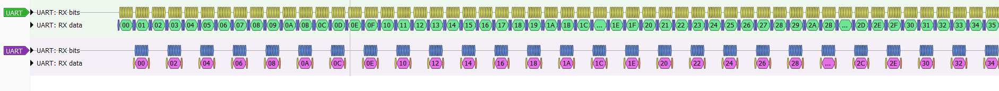

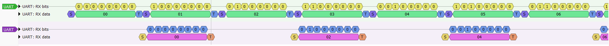

Capture file: `validation_tests/logic_analyzer/la_burst.sr` (open with PulseView).

### ILA capture: why the bytes are lost
To see inside the FPGA, a Vivado ILA (Integrated Logic Analyzer) was inserted
by marking signals with `(* mark_debug = "true" *)` (the UART lines,
`w_Rx_DV`, `w_Rx_Byte` and the transmitter state `r_SM_Main`) and using
Vivado's Set Up Debug wizard. The ILA samples on the 12 MHz design clock, so one
sample is one clock (83.3 ns) and one UART bit is 104 samples.

**Clean reference: one byte (`A`).** Trigger on `w_Rx_DV`, trigger position 1500,
so both frames are visible. The incoming `A` arrives on `ja[0]`; the receiver
signals `w_Rx_DV` in the middle of the stop bit; the transmitter then steps
through START_BIT (104 clocks), DATA_BITS (832), STOP_BIT (104) and CLEANUP (1),
sending the same pattern back out on `ja[1]`.

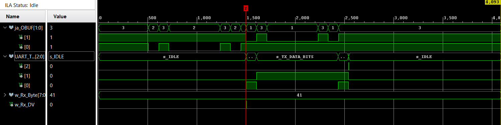

Zoomed in on the handover: the echo's start bit begins about half a bit before
the incoming stop bit ends.

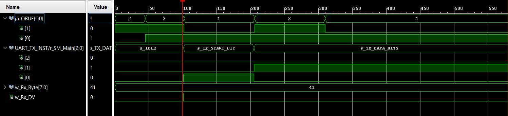

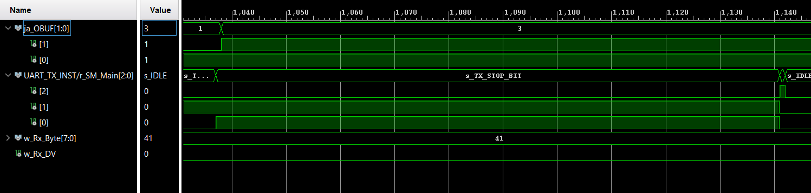

**The bug, caught at the exact clock.** Triggered on `w_Rx_DV` rising while
`w_Rx_Byte == 01` (the second byte of the burst). At that moment the transmitter
is still in `s_TX_STOP_BIT`, sending the stop bit of the previous echo, so the
one-clock "data valid" pulse is ignored and byte `01` is lost. The same happens
to every odd byte.

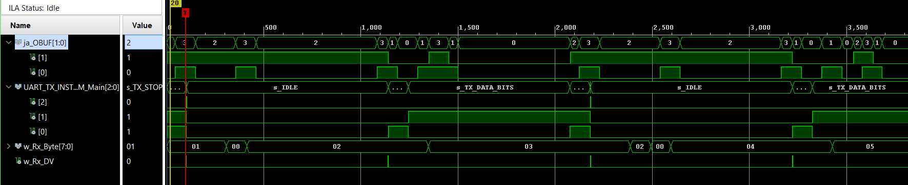

**Debug lesson:** the ILA was not detected at first ("debug hub core was not
detected"). The JTAG clock was 15 MHz, but the debug hub runs on the 12 MHz
design clock and must be at least 2.5× faster than JTAG. Lowering the JTAG
frequency to 1 MHz fixed it.

The ILA can also be triggered without Python: typing a character in a serial
terminal such as RealTerm produces the same `w_Rx_DV` pulse.

### Reproducing the bug in simulation
Before fixing anything, I recreated the bug in simulation, where every signal is
visible and a change takes seconds instead of a rebuild. The burst testbench
(`simulation/burst/uart_burst_tb.v`) plays the PC: one process sends 8 bytes
(`00`–`07`) with no gap between them, a second one listens to the echoes at the
same time, and a third stops the run and prints the result.

**Result:** 6 of 8 echoes, `00 01 03 04 06 07`. Bytes `02` and `05` were lost
(`simulation/burst/sim_burst_console.txt`).

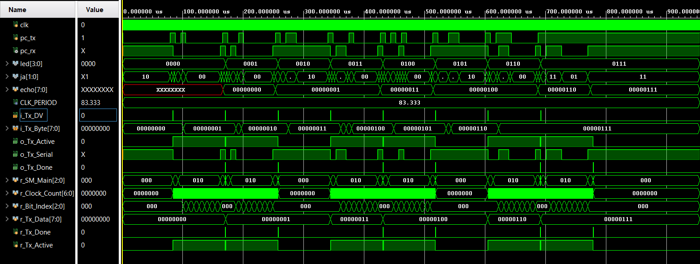

**Root cause, counted in clocks:**
- The transmitter needs **1,042 clocks** from accepting one byte to being able to
  accept the next: 10 bits × 104 clocks, plus one clock in CLEANUP and one in IDLE.
- At exactly 115,200 baud the testbench sends a byte every **1,041.67 clocks**.
  The FPGA only counts whole clocks, so the gaps between "data valid" pulses go
  1,042, 1,042, **1,041**, and repeat.
- On a 1,041 gap the pulse arrives **one clock too early**, while the transmitter
  is in CLEANUP, and it is ignored. So every third byte is lost.

At 257 µs, byte `02` arrives while the transmitter is still finishing byte `01`.
The pulse lands in CLEANUP (`r_SM_Main = 100`), and `r_Tx_Data` stays `01`:

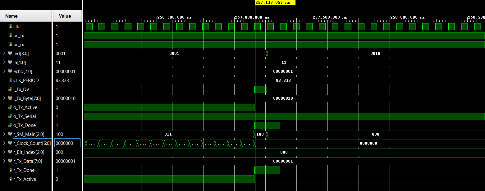

The transmitter goes straight from byte `01` to byte `03`:

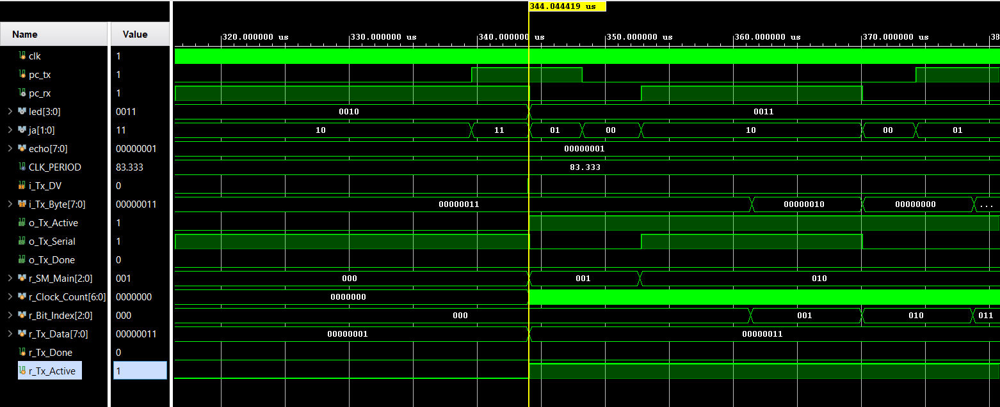

**Why hardware lost every other byte, not every third:** the board's USB-UART
chip most likely runs at 115,385 baud, the same as the FPGA (12 MHz / 104). That
is a byte every **1,040 clocks**, always **2 clocks too early**. This also matches
the ILA capture above, where the pulse arrived while the transmitter was still in
STOP_BIT.

**Lesson:** the bug is a race of 1 to 2 clock cycles out of 1,042. How many bytes
are lost depends on tiny baud differences, so the fix has to remove the race, not
tune the timing.

### The fix: a FIFO between RX and TX
The receiver now writes every byte into a 16-slot FIFO, and the transmitter takes
bytes out of it (see Design above). A byte that arrives while the transmitter is
busy waits in the FIFO instead of being lost.

- **Handshake:** a byte moves only when the FIFO has one (*valid*: not empty) and
  the transmitter can take it (*ready*: `o_Tx_Ready`). One signal starts the
  transmitter and reads the FIFO in the same clock, so they can't get out of step.
- **Why `o_Tx_Ready` and not `!o_Tx_Active`:** `o_Tx_Active` already drops when
  the transmitter enters CLEANUP, one clock before IDLE. Using it, the FIFO would
  hand over a byte during CLEANUP, the transmitter would ignore it, and the byte
  would be lost exactly as before. Readiness has to come from the state that
  actually accepts data.
- **Why a handshake alone isn't enough:** a handshake only works if the sender
  can wait. Here it can't: the receiver's "data valid" is a one-clock pulse, its
  byte register is overwritten by the next byte, and the PC can't be told to wait
  (no flow control). So the byte needs somewhere to wait, and that is the FIFO.

**FIFO unit test (`simulation/fifo/fifo_tb.v`).** The FIFO was tested on its own
first, with `DEPTH = 4` so it fills quickly:
first-in-first-out order, full flag, a write when full is refused (the extra byte
`EE` never comes out), a read when empty is refused, and a write and read in the
same clock leave the count unchanged. The pointers also wrap around during the
test. **Result: 9 of 9 checks pass** (`simulation/fifo/fifo_tb_console.txt`).

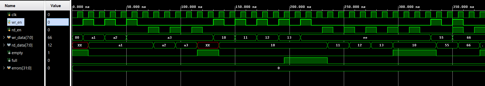

### Result after the fix
**Simulation** (`simulation/burst_fifo/`): the burst testbench now also checks
every echo's value, not just the count. **8 of 8 echoes, `00`–`07`, 0 wrong.**
The FIFO never holds more than 1 byte: each byte waits only about 2 clocks.

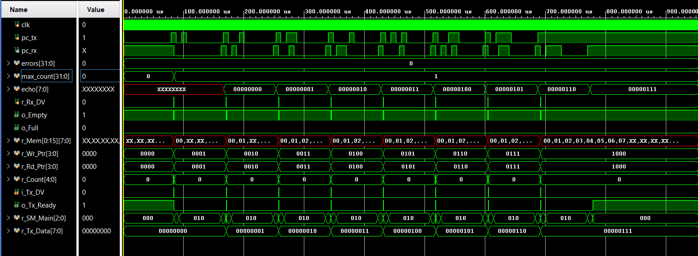

At 257 µs, the moment byte `02` used to be lost: the FIFO count goes 0 → 1 (byte
`02` waits), the transmitter reaches IDLE, the handshake fires, the count goes
back to 0 and `r_Tx_Data` becomes `02`.

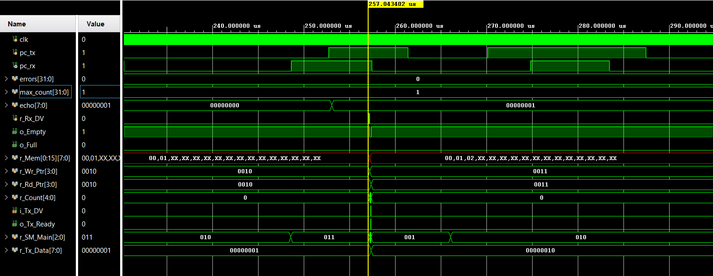

**Hardware:** pytest **257 passed** in 4.4 s, including the burst test that had
lost half the bytes.

**Logic analyzer:** the echo line now carries every byte, back to back, with no
gaps. Each echo starts about half a bit before its incoming frame ends, because
the receiver reports the byte in the middle of the stop bit: a latency of 9.5 bits
(≈ 82 µs).

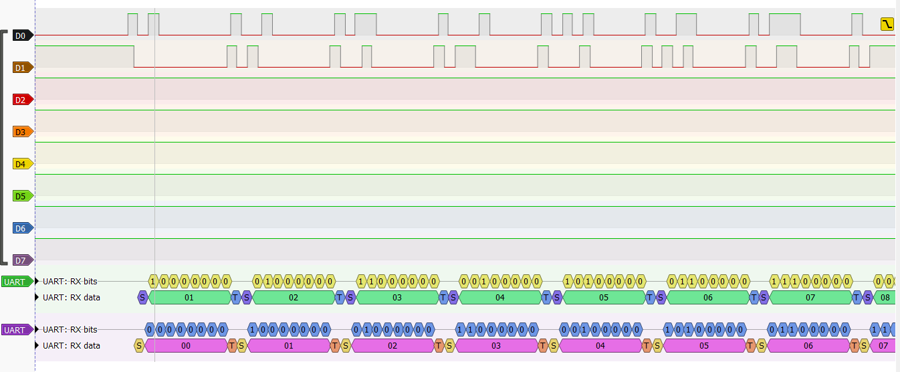

Capture file: `validation_tests/logic_analyzer/la_burst_fifo.sr`.

Git tags mark both versions: `v1.0-no-fifo` (the bug) and `v1.1-fifo` (the fix).

### Baud-rate margin test
The FPGA was kept at 115,200 baud while the PC talked at deliberately wrong
speeds. At each speed, all 256 byte values were sent one at a time and the echoes
checked (`validation_tests/baud_margin/`).

**Prediction:** from the bit timing (each sample drifts further from the middle
of its bit; the last data bit, D7, at 8.5 bit periods, fails first), the echo
should fail beyond about ±5–6%.

**Result:** the echo works from **109,000 to 121,500 baud (−5.4% to +5.5%)**,
almost symmetric, close to the prediction.

| Speed (baud) | Error | Correct |
|---|---|---|
| 108,500 | −5.8% | 140 / 256 |
| 109,000 | −5.4% | 256 / 256 |
| 121,500 | +5.5% | 256 / 256 |
| 122,000 | +5.9% | 177 / 256 |

Full logs: `baud_sweep_coarse.txt`, `baud_sweep_fine.txt`, `baud_sweep.csv`.

**Which receiver failed?** The echo has two receivers: the FPGA's (PC to FPGA)
and the PC's (FPGA to PC). The ILA's `w_Rx_Byte` shows what the FPGA received;
Python shows what the PC received.

| Speed | Byte sent | FPGA received (ILA) | PC received | Receiver that failed |
|---|---|---|---|---|
| 107,000 | `00` | `00` | `80` | PC's: its D7 sample landed on the echo's stop bit |
| 108,500 | `40` | `C0` | `C0` | FPGA's: its D7 sample landed in D6 |

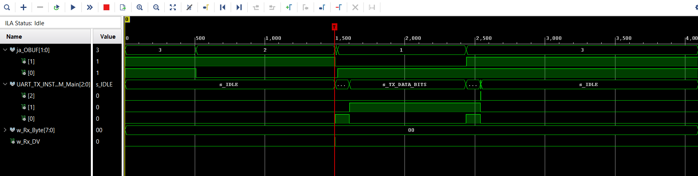

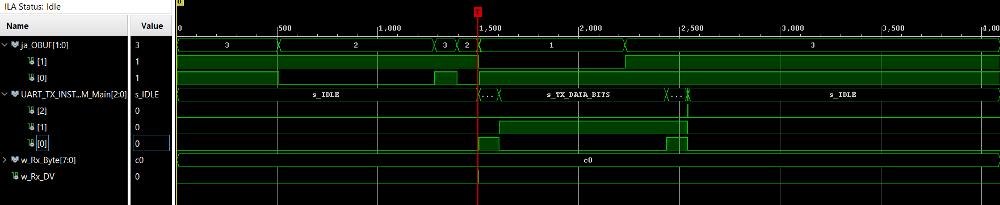

**What I got wrong:** I first predicted that every slow-side failure came from the
FPGA copying D6 into D7. The fine sweep showed `00 → 80` at 107,000, which that
explanation can't produce. The ILA showed the FPGA had received `00` correctly,
so the error was in the PC's receiver reading the echo.

**Error masking:** the two receivers' errors can cancel. For example, `0x80` sent
at 104,000: the FPGA receives `00` (D7 copies D6), and the PC then reads the
echo's stop bit into D7, giving back `80`. Python reports a pass even though the
FPGA received the wrong byte. A passing end-to-end test doesn't prove every stage
worked; only looking inside (ILA) shows it.
